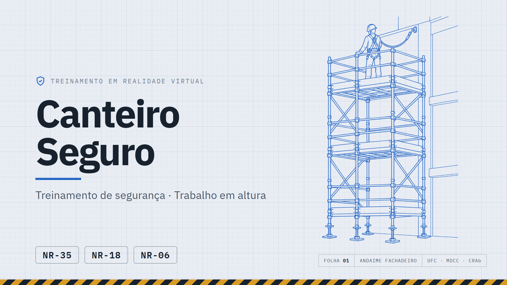

# safety-training-proto

<picture>
  <source media="(prefers-color-scheme: dark)" srcset="Assets/_SafetyProto/Art/Splash/splash_treinamento_seguranca_virtual_1920x1080.png">
  
</picture>

Modular VR training system for construction workers on Meta Quest 3, built
around the Brazilian occupational safety standards NR-01 (risk management),
NR-06 (PPE), NR-18 (construction), and NR-35 (work at height). It runs on Unity 6
with the Meta XR SDK and the Built-in Render Pipeline. An event-driven
architecture lets the same business logic run inside the Unity runtime and
inside a standalone .NET 10 CLI harness.

## Research context

This repository is the technical artifact of a Master's project at the Federal
University of Ceará (UFC), developed within CRAb (Computer Graphics, Virtual
Reality and Animations). Dissertation topic: event-driven architecture for VR
training systems with external participant extensibility. Author: Abner Augusto
Souza. Advisor: Prof. Dr. Joaquim Bento.

The architecture is published as *Decoupling XR Business Logic from Game
Engines: An Event-Driven Architecture for VR Safety Training*, Journal of the
Brazilian Computer Society 32 (2026), SVR 2026 track,
doi:[10.5753/jbcs.2026.8239](https://doi.org/10.5753/jbcs.2026.8239). Its
evidence is frozen at tag `v1.0.0`; see [Reproducing the paper's
evidence](#reproducing-the-papers-evidence).

## Architecture at a glance

<picture>
  <source media="(prefers-color-scheme: dark)" srcset="docs/images/architecture-dark.svg">
  
</picture>

<sub>Regenerate with `node docs/architecture/build-diagram.mjs`. Drawn in the style of <a href="https://iso-glow.vercel.app">ISO-GLOW</a>.</sub>

The central claim: the business logic (task orchestration, rule evaluation, log
persistence, scoring) is one compiled assembly shared between both runtimes,
and modules communicate only through a typed event protocol. External
participants — scripted actors, AI observers, remote peers — can join the
protocol without coupling to the engine. The CLI harness shows the three roles
such a participant can take: `ScriptedActor` produces events from a JSON script,
`HarnessPPEManager` stands in for the physics-driven PPE state, and
`TranscriptRecorder` observes every event.

## Documentation

| Read | For |
|---|---|
| [ARCHITECTURE.md](ARCHITECTURE.md) | Layers, the event bus and its protocol table, session lifecycle, PPE, scoring, session modes, the harness boundary, the dashboard, and the invariants a contributor must preserve |
| [docs/authoring-tasks.md](docs/authoring-tasks.md) | Scenario JSON fields, action and equip-set tasks, the Avalonia authoring GUI, and testing a scenario in the CLI harness |
| [docs/authoring-events.md](docs/authoring-events.md) | Adding, stamping, and subscribing to events |
| [docs/session-simulator.md](docs/session-simulator.md) | Replaying a scenario `script` in the Unity Editor without a headset |
| [docs/cli-harness-output.md](docs/cli-harness-output.md) | Reference CLI harness transcripts |
| [Tools/DashboardSrc/README.md](Tools/DashboardSrc/README.md) | Evaluator dashboard source and its generated Unity copies |
| [metrics/revision-evidence.md](metrics/revision-evidence.md) | Current test counts, coverage, coupling metrics, and scenario scores |
| [docs/bench-results.md](docs/bench-results.md) | EventBus benchmark results |

## Repository layout

```
safety-training-proto/
├── Assets/_SafetyProto/
│   ├── Scripts/
│   │   ├── Core/              # EventBus, EventPayloads, event facades, interfaces, logging
│   │   ├── Domain/            # Pure C# business logic (no UnityEngine), shared with the harness
│   │   ├── Runtime/           # MonoBehaviour adapters and scene-side systems
│   │   ├── Networking/        # Evaluator dashboard (HTTP/WebSocket server)
│   │   ├── UI/                # HUDs, task UI, popup system
│   │   ├── Utils/             # SessionLogger, extensions, helpers
│   │   └── Editor/            # Editor-only tools
│   ├── Scene/SafetyTraining.unity
│   ├── Resources/             # EventBus.asset, Scenarios/default.json, Actions/actions.json
│   └── Tests/Editor/          # NUnit edit-mode tests
├── Tools/
│   ├── SafetyProto.Shared/    # .NET 10 library, links Core/ + Domain/ source files
│   ├── SafetyProto.Tests/     # Headless NUnit suite and coverage configuration
│   ├── CliHarness/            # .NET 10 console app consuming Shared.dll
│   ├── EventBusBench/         # EventBus dispatch benchmark
│   ├── AuthoringApp/          # Console scenario validator (validate / info)
│   ├── AuthoringApp.Gui/      # Avalonia scenario and action editor
│   ├── DashboardSrc/          # Evaluator dashboard source
│   └── BrandSrc/              # Splash banner and app icon generator
├── docs/                      # Guides, benchmark results, README images
├── metrics/                   # Evidence for the paper and for main
├── scripts/                   # Android/authoring builds, evidence reproduction
└── SafetyProto.sln            # Shared, CliHarness, AuthoringApp, and Tests
```

## Building

### Unity

Open the project in Unity 6000.5.10f1 with Meta XR SDK v205.0.0 installed and
the Android target (Meta Quest 3). Press Play in the `SafetyTraining` scene to
run in the Editor, or build an APK with `scripts/build-android.ps1` or
`File → Build Settings`.

On a fresh clone, two third-party asset packages are gitignored (Asset Store
licensing) and must be imported manually before the UI renders correctly:

- **TextMesh Pro**: `Window → TextMeshPro → Import TMP Essential Resources`.
  Without this, all TMP text renders blank.
- **Dark UI**: import [Dark Theme UI](https://assetstore.unity.com/packages/2d/gui/dark-theme-ui-199010)
  (free, Giniel Villacote) from the Asset Store into `Assets/Dark UI/`.
  Without this, UI icons are missing.

### Shared library and CLI harness

```bash
dotnet build Tools/SafetyProto.Tests/SafetyProto.Tests.csproj -warnaserror
dotnet build Tools/CliHarness/CliHarness.csproj -warnaserror

# The argument is the output directory. The harness always plays
# Assets/_SafetyProto/Resources/Scenarios/default.json, the scenario Unity
# loads, and writes a transcript to stdout and session_log_*.json to
# harness-output/
dotnet run --project Tools/CliHarness -- harness-output
```

The authoring GUI is not in the solution; [docs/authoring-tasks.md](docs/authoring-tasks.md)
covers running and publishing it.

## Testing

```bash
dotnet test Tools/SafetyProto.Tests/SafetyProto.Tests.csproj
```

This runs the engine-independent fixtures without Unity. The Unity-coupled ones
run in `Window → General → Test Runner → EditMode`. Counts, coverage commands,
and per-fixture coverage are in [metrics/revision-evidence.md](metrics/revision-evidence.md).

The same build, the headless tests, and a harness smoke run execute as a
pre-push hook. Enable it once per clone with
`git config core.hooksPath scripts/git-hooks`; skip it deliberately with
`git push --no-verify`. The Unity EditMode suite is not part of the hook; run it
in the Editor before merging a change that touches a `MonoBehaviour`.

The EventBus benchmark runs with `dotnet run --project Tools/EventBusBench`;
results depend on the host and the reported run is in [docs/bench-results.md](docs/bench-results.md).

### Reproducing the paper's evidence

```bash
pwsh ./scripts/reproduce-manuscript-evidence.ps1   # Windows (PowerShell 7)
./scripts/reproduce-manuscript-evidence.sh         # macOS or Linux
```

The scripts check out tag `v1.0.0` in a throwaway worktree, collect coverage,
run both CLI scenarios, assert the published figures, and write logs plus a
summary to `artifacts/reproduction/`. They need the tag locally
(`git fetch --tags`). The frozen figures are in
[metrics/revision-evidence-1.0.0.md](metrics/revision-evidence-1.0.0.md).

### On the headset

After an APK build, install with `adb install`, then put on each required PPE,
perform each task, and confirm the session summary appears. Pull the log with:

```bash
adb pull /sdcard/Android/data/com.abnersouza.SafetyProto/files/
```

## Current status

- Event-driven architecture with shared business logic.
- Automated NUnit suite covering rule evaluation, scoring, the risk model,
  session orchestration, and domain-stack integration.
- CLI harness with producer, observer, and state-stub participant roles.
- Session log format shared by the headset and the CLI harness.
- Quest APK build validated with the construction-safety scenario on Meta Quest 3.
- Desktop authoring application for JSON scenarios and action catalogs.
- Evaluator dashboard for live session, task, score, and pose monitoring.

## Version and environment

- Unity 6 (6000.5.10f1)
- Meta XR SDK v205.0.0 (`com.meta.xr.sdk.all`)
- OpenXR plugin 1.17.1, XR Hands 1.8.1
- Built-in Render Pipeline
- .NET 10 SDK for the Shared library, CLI harness, and Avalonia authoring app
- Target device: Meta Quest 3 — Android (min SDK 32, target SDK 34)
- App version 1.2.4 (Android versionCode 18)
